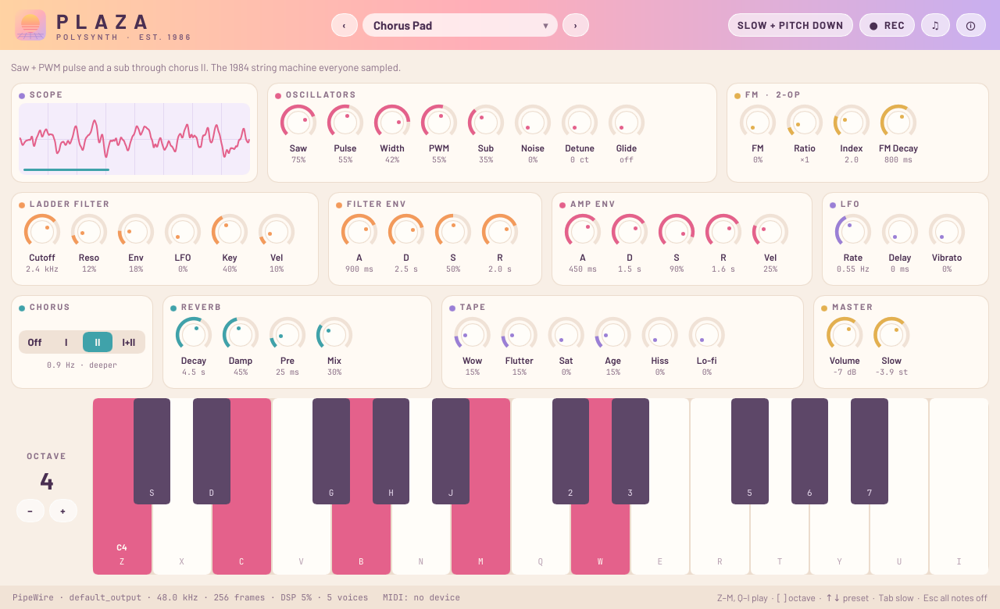
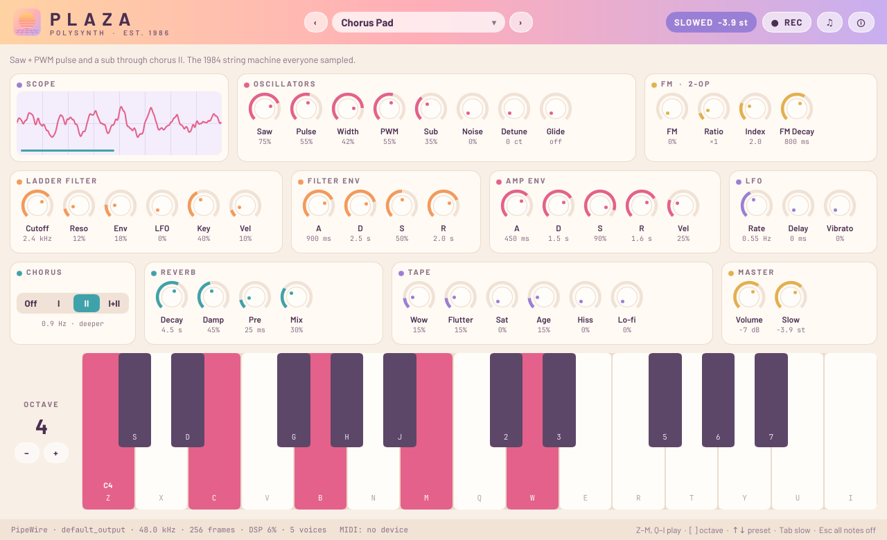
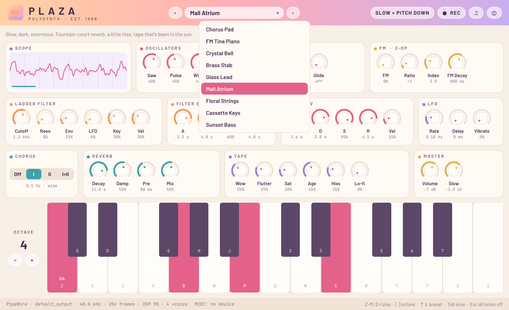

# Plaza

An 80s-style polysynth for making vaporwave, for Linux, Windows and macOS. An ensemble chorus, a big modulated reverb, a cassette stage, and a slow + pitch down switch. Everything is synthesized; there are no samples. Rust, [Slint](https://slint.dev) UI, [cpal](https://github.com/RustAudio/cpal) audio (PulseAudio or PipeWire on Linux, WASAPI on Windows, CoreAudio on macOS), [midir](https://github.com/Boddlnagg/midir) for USB MIDI. It makes no network connections.

Free and open source, from [Center Point Labs](https://centerpointlabs.dev/services/plaza/). Inspired by classic 80s polysynths and FM keyboards; not affiliated with any instrument maker.

> [!WARNING]
> **Turn your volume down before the first note.** Long reverb tails, resonant filters and stacked chords can get loud fast, especially on headphones. Plaza's limiter stops digital clipping at 0 dBFS, but it can't know how loud your speakers are.



| | |
|---|---|
|  |  |

Demo clips, rendered offline by `plaza render` with no processing afterwards, are attached to the [v0.1.0 release](https://github.com/nunyabiz765/plaza/releases/tag/v0.1.0) and play on the [Center Point Labs page](https://centerpointlabs.dev/services/plaza/).

## The sound

Signal path, per voice (8-voice polyphony):

- **Oscillators:** PolyBLEP saw (with an optional detuned second saw), pulse with PWM from the LFO, square sub one octave down, white noise. Free-running phases plus a couple of cents of slow random drift per voice, so chords never sound perfectly frozen.
- **FM layer:** a 2-operator sine pair (modulator ratios 0.5 to 14) with its own index envelope that decays toward a floor. Velocity opens the index, as on classic FM keyboards. The index is pulled back on high notes to keep sidebands under Nyquist.
- **Ladder filter:** 4-pole zero-delay-feedback ladder with a saturating input stage. Resonance up to self-oscillation; half the bass loss is given back as resonance rises. Its cutoff responds to the envelope, LFO, key tracking and velocity.
- **Envelopes:** analog-style ADSRs for the filter and the amp (RC-curve attack, exponential decay/release). Notes retrigger from the current level, so fast playing and voice stealing don't click.
- **LFO:** global triangle with a per-voice delay/fade-in, for vibrato, PWM and filter.

Then the shared effects:

- **Chorus:** two modulated delay lines swept by one triangle in antiphase, darkened like a bucket-brigade (BBD) chip. Modes I (0.513 Hz), II (0.863 Hz) and I+II (9.75 Hz, shallow), at the rates classic 80s polysynth choruses used.
- **Reverb:** 8-line feedback delay network (Hadamard mixing), four input diffusers, per-line damping, and slowly wandering delay taps for a chorused, non-metallic tail. Decay 0.5 to 20 s, plus pre-delay.
- **Tape:** asymmetric saturation (normalised so small signals pass at unity), head-loss roll-off ("Age"), wow and flutter on one shared transport with slow random drift, hiss, and an optional sampler-style lo-fi stage (sample-and-hold down to about sr/7, and down to 6 bits).
- **Master:** volume, DC blocker, and a soft-knee limiter that is transparent below −2 dBFS and never goes past 0 dBFS.

**Slow + pitch down** (Tab, or the header button) plays everything at a slower "tape speed", 0.5 to 0.95, default 0.8 (−3.9 semitones). Pitch drops, envelopes, LFO, wow and the reverb decay all stretch by the same factor, and it eases in over about a third of a second, like a deck spinning down. The Slow knob in Master sets how far.

Parameters glide over about 15 ms, so turning knobs or switching presets doesn't zipper or click.

### Presets

| | |
|---|---|
| **Chorus Pad** | Saw + PWM pulse + sub through chorus II |
| **FM Tine Piano** | 2-op FM electric piano, 1:1, chorus I |
| **Crystal Bell** | FM at 3.5:1, glassy and inharmonic, long ring |
| **Brass Stab** | Detuned saws, snappy filter envelope |
| **Glass Lead** | Narrow pulse over saw, poly glide, delayed vibrato |
| **Mall Atrium** | Slow, dark, huge reverb, hiss and sun-worn tape |
| **Floral Strings** | Bright ensemble with the I+II shimmer |
| **Cassette Keys** | Pulse + FM keys through a cheap sampler and a worn tape |
| **Sunset Bass** | Sub-heavy round bass with a soft pluck |

**Sound Pack 1** (since 0.1.3): mid-80s drum-machine synth-pop. Bright, chorused, sequenced.

| | |
|---|---|
| **Glasshouse Poly** | Two wide-detuned saws and a thin pulse through chorus II; bright, glassy chords |
| **Night Bus Seq** | Short resonant pluck for 16th-note sequences; velocity opens the filter |
| **Towpath Bass** | A bass voice built to play the tune up high: bright saw, chorus I, some bite |
| **Redbrick Strings** | String-machine ensemble: wide saws, slow PWM and the I+II shimmer |
| **Overcast Brass** | Hard, bright poly stab: detuned saws, a fast filter blip, a little drive |
| **Platform Bell** | Digital FM bell at 7:1 over a thin pulse, for countermelodies |

Double-click any knob to return it to the preset's value.

## Playing

Computer keyboard, two octaves in tracker layout:

```
 S D   G H J     2 3   5 6 7          black keys
Z X C V B N M   Q W E R T Y U I      white keys
lower octave    upper octave
```

`[` `]` or ← → change octave · ↑ ↓ change preset · Tab toggles slow · Esc releases every note. You can also click the on-screen keys. Keys pressed with Ctrl (or ⌘ on a Mac) are left to the system, so ⌘Q, ⌘H and the like work as usual.

**USB MIDI:** plug in a keyboard and Plaza connects to the first real input port within about 3 seconds, and reconnects after unplug/replug. Notes with velocity, pitch bend (±2 semitones), mod wheel (vibrato), sustain pedal (CC64) and All Notes Off are supported, on any channel. The status bar shows the port name.

**Recording:** the ● REC button writes what you hear to `plaza-YYYYMMDD-HHMMSS.wav` (24-bit, at the device rate, usually 48 kHz) in a Plaza folder inside your Music folder: `~/Music/Plaza` on Linux and macOS, `Music\Plaza` in your user folder on Windows. ♫ opens that folder.

## Audio

On Linux, Plaza talks to the sound server over PulseAudio's protocol, which PipeWire also serves (pipewire-pulse, standard on Ubuntu 24.04 and most current desktops), falling back to ALSA. Since 0.1.3 it no longer links libpipewire, whose Ubuntu 22.04 version is too old for cpal's native PipeWire host. Windows uses WASAPI (shared mode) and macOS CoreAudio, each on the system's default output device. It asks for a 256-frame buffer (5.3 ms at 48 kHz) so the keys feel immediate; if the server refuses, it falls back to the server's default. `PLAZA_BUFFER=512 plaza` picks another size, and `PLAZA_BUFFER=0` uses the server default. The audio callback doesn't lock or allocate, and it turns on flush-to-zero so decaying tails can't cause denormal CPU spikes. The status bar shows the buffer size, worst-case DSP load, active voices, and xruns if any happen.

## Command line

```sh
plaza                                 # open the synth
plaza --preset "Mall Atrium"          # start on a preset
plaza --muted                         # run the engine but send silence
plaza presets                         # list presets
plaza midi                            # list MIDI input ports
plaza render -o out.wav --slow 'Mall Atrium=chords' 'Glass Lead=melody'
plaza probe 10                        # real-time stream for 10 s, MUTED, prints timing
plaza bench                           # offline DSP speed
```

`render` plays built-in phrases (`chords keys melody stabs bass scale`) through the full engine offline and writes a 24-bit WAV. Several `PRESET=PHRASE` layers are summed. With `--slow`, the timing stretches too, like a slowed record.

## Install

### Windows 10/11 (x86_64)

Download `plaza-0.1.3-windows-x86_64.zip` from the [latest release](https://github.com/nunyabiz765/plaza/releases/latest), unzip it anywhere and double-click `Plaza.exe`. It's portable: nothing is installed, no admin rights are needed, and deleting the folder removes it.

Plaza isn't code-signed yet, so the first launch shows SmartScreen's **"Windows protected your PC"**. Click **More info**, check the app is `Plaza.exe`, then **Run anyway**.

### macOS 11 or newer (Apple Silicon and Intel)

Download `plaza-0.1.3-macos-universal.dmg` from the [latest release](https://github.com/nunyabiz765/plaza/releases/latest), open it and drag Plaza into Applications.

Plaza is signed with a Developer ID and notarized by Apple (since 0.1.2), so it opens like any other downloaded app.

### Ubuntu, Zorin OS, Linux Mint, Pop!_OS (.deb)

Download `plaza_0.1.3_amd64.deb` from the [latest release](https://github.com/nunyabiz765/plaza/releases/latest) and double-click it. The Software app (or Mint's package installer) opens; click **Install** and enter your password. Plaza appears in the app menu. No terminal needed. From a terminal it's `sudo apt install ./plaza_0.1.3_amd64.deb`.

One .deb covers Ubuntu 22.04 and 24.04 and the distros built on them (Zorin OS 17 and 18, Linux Mint 21 and 22, Pop!_OS 22.04 and 24.04). Uninstall from the Software app, or `sudo apt remove plaza`. Recordings in `~/Music/Plaza` are kept.

### Prebuilt binary (any x86_64 Linux)

Download `plaza-0.1.3-x86_64-linux.tar.gz` and its `.sha256` from the [latest release](https://github.com/nunyabiz765/plaza/releases/latest), then:

```sh
sha256sum -c plaza-0.1.3-x86_64-linux.tar.gz.sha256
tar xf plaza-0.1.3-x86_64-linux.tar.gz
cd plaza-0.1.3-x86_64-linux
./install.sh
```

The binary was built on Debian 12 and needs glibc 2.35 or newer. At run time it needs the ALSA library (`alsa-lib` / `libasound2`), a PulseAudio or PipeWire (with pipewire-pulse) sound server, fontconfig and xkbcommon, which nearly every desktop already has.

### From source

Needs Rust (stable) and the development files for ALSA, fontconfig and xkbcommon:

```sh
# Arch
sudo pacman -S --needed rust alsa-lib fontconfig libxkbcommon
# Debian / Ubuntu
sudo apt install build-essential pkg-config libasound2-dev libfontconfig1-dev libxkbcommon-dev
# Fedora
sudo dnf install rust cargo alsa-lib-devel fontconfig-devel libxkbcommon-devel

git clone https://github.com/nunyabiz765/plaza
cd plaza
./install.sh
```

Only the Arch line has been tried. `install.sh` installs `~/.local/bin/plaza`, a desktop entry and icons under `~/.local/share`, and touches nothing outside your home directory. The release build needs about 2 GB of scratch space; on a full disk, build elsewhere: `CARGO_TARGET_DIR=/tmp/plaza-target ./install.sh`.

To uninstall:

```sh
rm ~/.local/bin/plaza ~/.local/share/applications/plaza.desktop ~/.local/share/icons/hicolor/*/apps/plaza.*
```

## Development

```sh
cargo test --release      # DSP unit tests + offline render checks (34 tests)
tools/shots.sh            # retake docs/screenshots on a private Xvfb display (runs --muted)
tools/build-release.sh OUT  # Linux release tarball + .deb, built in a Debian 12 container (podman)
```

Windows and macOS builds come from GitHub Actions (`.github/workflows/release.yml`): pushing a `v*` tag builds all three platforms, runs the tests on each, and attaches the Linux tarball and .deb (after installing the .deb on clean Ubuntu 22.04 and 24.04 containers), the Windows zip and the macOS .dmg to that tag's release. To build on Windows or macOS yourself, install Rust and run `cargo build --release`; nothing else is needed. `tools/package-windows.sh` and `tools/package-macos.sh` make the zip and the universal `.app`/`.dmg`.

The sound engine is `src/` minus `main.rs`, `app.rs`, `audio.rs` and `midi.rs`. It's a UI-free library, so every test runs headless. The tests cover:

- oscillator pitch, and slow mode landing on the right pitch
- the ladder's −50 dB-plus stopband and its stability at full resonance under modulation
- ADSR timing
- reverb decay rate and stability at a 20 s decay
- chorus transparency when off and stereo width when on
- wow depth (pitch stays within ±2.5% and actually moves)
- unity small-signal gain through the saturator, and bit-crush quantisation
- polyphony, stealing, sustain pedal and retrigger
- the limiter never exceeding 0 dBFS
- knob slams not clicking
- every preset rendering, slowed and not, to sane levels, deterministically, with tails that die out

`PLAZA_HOLD="60,64,67"` holds notes at startup. It's for screenshots.

## Ubuntu and Zorin OS .deb (v0.1.3, 2026-11-07)

The 0.1.1 and 0.1.2 Linux binaries linked libpipewire 0.3.53+ and wouldn't start on Ubuntu 22.04 (PipeWire 0.3.48): `undefined symbol: pw_stream_get_time_n`. 0.1.3 drops that link and talks PulseAudio's protocol instead. Tested in clean `ubuntu:22.04` and `ubuntu:24.04` containers, the bases of Zorin OS 17 and 18:

- `apt install ./plaza_0.1.3_amd64.deb` resolves every dependency (ALSA is `libasound2` on 22.04, `libasound2t64` on 24.04), `ldd` finds every library, and `apt remove` leaves nothing behind.
- `desktop-file-validate` passes, and so does `appstreamcli validate` (22.04's older appstream notes the `<developer>` tag as unknown, which is informational).
- Offline render, the real-time engine against a PulseAudio server with only a null sink (output muted, 0 xruns), the window on Xvfb, and REC from the window: `~/Music/Plaza` is created on the first recording and gets a 24-bit WAV.
- On Arch with PipeWire 1.6 (pipewire-pulse), the muted probe runs on the real sound card at 256 frames, 0 xruns.

Not tested: a real Zorin OS install, the GNOME Software / Zorin Software double-click flow, Wayland sessions on GNOME, and audible playback on any of them.

## Windows and macOS (v0.1.1, 2026-11-06)

Built by GitHub Actions on every tag (`windows-latest`, `macos-latest`); all 34 tests pass on Windows, macOS and Linux there.

- **Windows:** on the CI runner (Windows Server, x86_64), `Plaza.exe` renders offline and its window opens and stays up (screenshot taken there; muted, the runner has no sound card). The .exe is a GUI app with the icon embedded, and it only needs Windows' own DLLs. **Not run on a real Windows 10/11 PC yet**: sound output through WASAPI, MIDI, SmartScreen and HiDPI scaling are untested.
- **macOS:** on a MacBook Air (Apple Silicon, macOS 26), the .dmg's universal `Plaza.app` opened its window, and `plaza probe` ran the real-time engine on CoreAudio (MacBook Air speakers, 48 kHz, 256 frames, worst callback 4.9% of its budget, output muted, one xrun reported). The x86_64 half rendered offline under Rosetta on CI. **Not tested:** audible playback, MIDI, an Intel Mac, and the Gatekeeper first-open steps (the test copy wasn't downloaded through a browser, so it had no quarantine flag).
- On a small screen, Windows' 150% scaling on a 1080p laptop leaves 1280×720 of room, a little less than Plaza's 1200×740 minimum window size.

## Tested / not tested (v0.1.0, 2026-11-06)

Tested on one machine: x86_64 Arch Linux, KDE Plasma 6.7 on Wayland, PipeWire 1.6.

- All 34 unit and render tests pass.
- Played on the real KDE Plasma Wayland desktop with the computer keyboard, through PipeWire.
- Offline renders: the demo clips, plus every preset alone, slowed and not. Checked with ffmpeg for format, peak, RMS, DC offset and stereo width, and with spectrograms for aliasing.
- The real-time engine on PipeWire with output muted: `plaza probe` at 256 frames gave 2,809 callbacks in 15 s, 0 xruns, worst callback 10% of its budget, with 8 voices and the reverb on. At 1024 frames it was 7%, and at 128 frames 16% with 0 xruns.
- Offline worst case (8 voices, every layer and effect on): about 3.5% of one core.
- The GUI on a private Xvfb display: computer-keyboard notes on and off, preset menu, slow toggle, the About dialog, and recording to WAV end to end (a 5.1 s, 24-bit file with real audio in it).
- The release tarball's binary (built on Debian 12) on Arch: checksum, install layout, offline render, the muted real-time probe (0 xruns), and the window on Xvfb.

Not tested:

- **USB MIDI keyboards.** No device was connected; only ALSA's "Midi Through" port exists, and Plaza skips it on purpose. The MIDI parsing is unit-tested, but connecting, hot-plug and playing from a real keyboard are not.
- Recording (REC) on the real desktop. It was tested on Xvfb only.
- HiDPI scaling, other desktops (GNOME, X11 sessions) and other distributions.
- Audio devices other than a stereo float PipeWire sink.
- Losing window focus while holding a key could leave a note hanging until you press Esc.

## License

Plaza's own code is licensed under either of [MIT](LICENSE-MIT) or [Apache-2.0](LICENSE-APACHE), at your option.

It's built with Slint, used under the [Slint Royalty-free Desktop, Mobile, and Web Applications License 2.0](LICENSES/LicenseRef-Slint-Royalty-free-2.0.md). Slint isn't covered by the MIT and Apache terms. The app shows the required attribution with the `AboutSlint` widget in its About dialog (the ⓘ button at the top right). If you distribute a modified build, keep that widget or follow the license's other attribution option. See [NOTICE](NOTICE). Release tarballs include the licenses of the other Rust crates in `THIRD-PARTY-LICENSES.txt`.

Preset names are descriptive. Plaza is not affiliated with or endorsed by any instrument maker.

<a href="https://slint.dev"></a>
